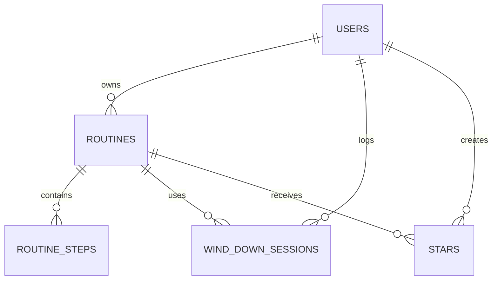

# Wind Down Build Plan

## 1. Pitch

I’m building Wind Down because I want a calmer way to pause before opening Instagram at bedtime. I expect to use it most nights, about five to seven times a week, and use the session history to see whether my routine is helping.

## 2. Features

Build these in order. Each feature gets its own issue, branch, pull request, and prompt file in `prompts/`.

1. **Sign up and login:** As a user, I want to create an account, log in, and log out so that my Wind Down data stays private to me.
2. **Data model:** As a user, I want my routines, routine steps, and Wind Down sessions saved in related tables so that I can return to my data later.
3. **Session management (CRUD):** As a user, I want to add, view, open, edit, and delete a Wind Down session so that I can keep an accurate history.
4. **Validation:** As a user, I want a friendly message when I leave a required field blank so that I know how to fix the entry.
5. **Starred routines:** As a user, I want to star routines and view my starred routines so that I can quickly find the ones I use most.
6. **Find and sort:** As a user, I want to search or filter sessions and sort them by date or outcome so that I can find a particular night.
7. **Dashboard:** As a user, I want to see a chart of my sessions over time and summary stats so that I can understand my bedtime habits.
8. **iPhone Shortcut:** As a user, I want my iPhone Shortcut to start a Wind Down check when I open Instagram so that I get a pause before using it at bedtime.
9. **10-minute bypass:** As a user, I want the option to continue for 10 minutes so that I can make a deliberate choice without losing the rest of the routine.
10. **Three-step routine:** As a user, I want a short, three-step bedtime routine so that I have a simple alternative to continuing to scroll.

The data isolation test will be added with the sign-up and login feature. The dashboard calculation test will be added with the dashboard feature. Each test’s pull request will include the required plain-English explanation, failing and passing screenshots, and one sentence about what change would make the test fail.

## 3. Database

The app will use these tables. IDs are text values. Dates include date and time where needed.

- **users:** `id` (text, primary key), `email` (text, unique), `password_hash` (text), `created_at` (date).
- **routines:** `id` (text, primary key), `user_id` (text, foreign key to `users.id`), `name` (text), `is_active` (true/false), `created_at` (date).
- **routine_steps:** `id` (text, primary key), `routine_id` (text, foreign key to `routines.id`), `step_number` (number), `label` (text), `duration_minutes` (number).
- **wind_down_sessions:** `id` (text, primary key), `user_id` (text, foreign key to `users.id`), `routine_id` (text, optional foreign key to `routines.id`), `started_at` (date), `ended_at` (date, optional), `outcome` (text: pause, bypass, or routine completed), `minutes_delayed` (number), `note` (text).
- **stars:** `id` (text, primary key), `user_id` (text, foreign key to `users.id`), `routine_id` (text, foreign key to `routines.id`), `created_at` (date). A user can star a routine only once.

Relationships: one user can have many routines and sessions; one routine can have many steps and sessions; users and routines have a many-to-many relationship through `stars`.

> **Post-build documentation note — 2026-11-04.** The original plan as merged was incomplete: it ends inside the section 3 Mermaid diagram. The closing fence and sections 4–7 below are a post-build completion of the assignment record, not original advance planning. They do not repair or rewrite the original plan retroactively.

## 4. Acceptance tests and existing evidence

### User data isolation

- **Given** User A owns a Wind Down session.
- **When** User B requests that session's detail endpoint.
- **Then** User B receives `404`; when User A requests the same session, User A receives `200`.

The automated test is [`wind-down-session-isolation.test.ts`](artifacts/api-server/src/routes/wind-down-session-isolation.test.ts). Its fixtures are synthetic and are deleted by the test. The genuine red/green evidence from [PR #4](https://github.com/drishtidhandhania-alt/wind-down-app/pull/4) is linked here: [red failure screenshot](generated-artifacts/data-isolation-red.jpg) and [green passing screenshot](generated-artifacts/data-isolation-green.jpg).

### Dashboard calculation

- **Given** three synthetic sessions with recorded `minutesDelayed` values of 5, 10, and 15.
- **When** the dashboard statistics function is run.
- **Then** the average recorded delay is 10 minutes.

The pure function used by the Dashboard is tested in [`dashboard-stats.test.ts`](artifacts/wind-down/src/lib/dashboard-stats.test.ts). The fixtures are in memory, not saved user history. Existing genuine red/green evidence from [PR #19](https://github.com/drishtidhandhania-alt/wind-down-app/pull/19) is documented in [`generated-artifacts/dashboard/TEST.md`](generated-artifacts/dashboard/TEST.md), with its [red log](generated-artifacts/dashboard/red-test.log), [red screenshot](generated-artifacts/dashboard/red-test.jpg), [green log](generated-artifacts/dashboard/green-test.log), and [green screenshot](generated-artifacts/dashboard/green-test.jpg). This documentation pass does not recreate or alter those tests or screenshots.

Synthetic tests do not count as genuine saved sessions. No seed records were added. The owner's account now holds seven genuine sessions: five retrospective entries with user-supplied approximate times, labeled retrospective with `endedAt` null, plus a live routine completion on November 3 and a bypass with a short reason on November 4. A dashboard screenshot of this real saved data was captured and reviewed.

## 5. Technology and implementation choices

- **Web app:** React, TypeScript, Vite, and Tailwind CSS. React Query handles server-state requests and cache updates; Wouter handles client routes; Recharts renders the dashboard chart.
- **API and data:** Express validates browser and Shortcut requests, Drizzle ORM defines and queries PostgreSQL tables, and the `pg` package connects to PostgreSQL.
- **Authentication:** Passwords are stored as salted Node.js `scrypt` derivations. Sign-in creates a random `HttpOnly` cookie token; only its SHA-256 hash is stored in `auth_sessions`. The cookie is `SameSite=Lax`, and is marked secure when the request is secure. Authenticated session reads and writes are scoped by `user_id`.
- **Shortcut trust boundary:** The Shortcut does not use the browser login cookie. It sends a private tester token; the server looks up its stored hash and, for session history, uses the linked tester's `user_id`. Tester events belong to the tester. Browser history, stars, and dashboard queries remain user-scoped.
- **Hosting:** Replit artifact routing serves the Wind Down web artifact at `/` and routes `/api` to the Express API service. `.replit` specifies Node.js 24 and PostgreSQL 16; artifact configuration sets web port `22083` and API port `8080`.
- **Build process:** Replit Agent was used to build and verify the project in the Replit workspace; it is not a runtime dependency.
- **Reuse and custom work:** The project reuses the workspace package setup, generated API client, existing UI/component libraries, and Replit artifact hosting. The bedtime-window decision, private-token linkage, ownership checks, event/session logging, history behavior, and dashboard calculation are Wind Down-specific application code—not features supplied automatically by Replit.

## 6. Visual direction

The shipped interface uses a dark plum background (`#1B1A2E`), plum cards (`#26243D`), warm cream text (`#F3EEE6`), apricot primary action (`#E8A87C`), lavender highlights (`#8E86C9`), and sage success (`#9CBFA7`). Google Fonts load Fraunces for display headings, DM Sans for the interface, and DM Mono for small labels and timers. The implementation favors rounded surfaces, readable contrast, and restrained transitions.

The original plan records no visual inspiration source. Any comparison to Calm or Headspace is a post-build comparison only, not documented historical inspiration.

## 7. Plan vs. reality, decisions, and remaining work

The current database has six tables: `users`, `auth_sessions`, `wind_down_testers`, `wind_down_events`, `wind_down_sessions`, and `stars`. There are no `routines` or `routine_steps` tables. Users can own a linked tester; tester events are related to that tester. A saved session has a direct user owner. Stars attach to sessions, not routines. The optional session `routine_id` is plain nullable text, not a foreign key.

The dashboard's average uses only non-null `minutesDelayed` values. Empty data or no measured delays yields no average, not zero. Bypass and routine-completion records leave delay null when elapsed delay was not measured. The completed-session count means `endedAt` is present. The chart counts session `startedAt` dates across the browser's local seven-calendar-day window; legacy routine requests without a captured start use their completion log time.

The owner verified the physical-device flow on November 4, 2026. The flow remains dependent on iOS Personal Automation and Safari-to-Instagram behavior; this verification was user-reported, not automated or server-side.

| Planned feature | Shipped / Changed / Cut | Status (Done/Backlogged) | Learning | What changed and why |
| --- | --- | --- | --- | --- |
| Sign-up, login, and private user data | Implemented email/password accounts and ownership-scoped history APIs. | Done | A successful UI login is not enough; every data query also needs an owner constraint. | Cookie-backed sessions and explicit `user_id` filters keep account data isolated. |
| Routines, routine steps, and sessions as related data | Shipped sessions and six actual tables; no configurable routine tables. `routine_id` is nullable text without an FK. | Done | Normalize only what the shipped workflow needs; a descriptive field is not a relationship unless the database enforces it. | The app keeps one fixed three-step routine instead of adding unused routine-management tables. |
| Session create, list, detail, edit, delete, and validation | Implemented user-scoped session history and friendly required-field validation. | Done | Isolation belongs in list and detail queries as well as mutations. | CRUD uses the existing session table and the authenticated user's ID. |
| Starred routines | Changed to starring sessions, with a starred-session view. | Done | The persisted entity should match the feature the interface actually exposes. | There is no routine entity to star; the unique user/session pair prevents duplicate stars. |
| Search and sorting | Implemented history search and newest/oldest sorting over the signed-in user's sessions. | Done | Search and sort should operate on the same already-scoped collection. | No new schema was needed. |
| Dashboard totals, average, completion count, and chart | Implemented a shared tested calculation and seven-day browser-local chart. Null delay values are excluded; completed means `endedAt` exists. | Done | A null measurement is different from a measured zero; synthetic fixtures verify logic but are not user records. | Delay is not inferred from a 10-minute bypass or a routine. The chart uses local calendar dates. |
| iPhone Shortcut and Instagram pause | Implemented Setup instructions, a tester-token check, pause decisions, and a saved bypass choice. | Done | Server and browser checks do not prove iOS behavior; the owner verified it directly on a physical iPhone on November 4, 2026. | The owner confirmed Instagram opens Wind Down, the reasoned 10-minute bypass returns to Instagram, and the routine saves from the phone. |
| Ten-minute bypass and three-step routine | Implemented the exact 10-minute bypass and fixed steps: phone on charger, brush teeth, read for five minutes. Completion is saved to history. | Done | A granted bypass is not evidence that the person actually delayed ten minutes. | `minutesDelayed` stays null unless the duration is truly measured. |
| Configurable routine templates and routine-step editor | Cut; only the existing fixed three-step routine is available. | Backlogged | A fixed flow does not need routine CRUD tables, but it cannot support user-defined routines. | Kept scope small and reused the existing routine rather than inventing persistence for unused editing features. |
| Five genuine sessions and a real-data screenshot | The owner account has seven genuine sessions: five retrospective entries with user-supplied approximate times (`endedAt` null), a routine completion on November 3, and a reasoned bypass on November 4; the real-data dashboard screenshot was captured and reviewed. | Done | Tests establish behavior, not real-world usage or populated history. | No sample data or fabricated dates were added; retrospective entries use the owner's approximate times and are labeled retrospective. |
| Red/green test evidence | Existing PR #4 isolation evidence and PR #19 dashboard evidence are linked above. | Done | Keep the test assertion unchanged and mutate only an isolated implementation for red/green proof. | Existing evidence is referenced as produced; this documentation pass did not recreate it. |
